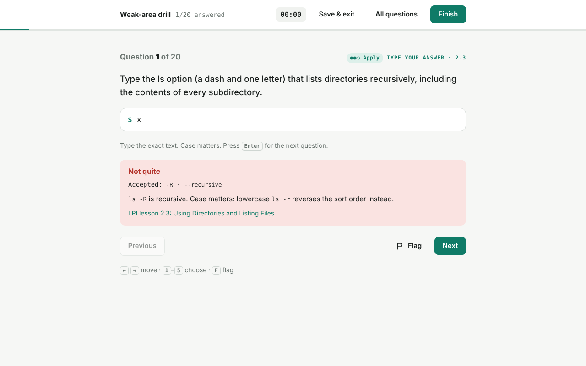

# exit 0

**Free practice for LPI Linux Essentials 010-160.** In Linux, `exit 0` means success, which is the goal here.

exit 0 is a free, open source study app for the **LPI Linux Essentials (010-160)** exam. It runs in the browser with
nothing to install and works on desktop and mobile, in light or dark mode.


## What's inside

- **Practice tests.** Each test has 40 questions and a 60-minute timer, drawn fresh from 240 questions with
  **exactly** as many questions per objective as the real exam (LPI: weight = number of questions).
- **Progress.** A readiness score (average of your last three tests), score trend, troubled sections,
  mastery of each objective, accuracy by difficulty, and a full history you can review.
- **Weak areas.** Replays the questions you missed, then your weakest objectives, with instant explanations.
- **Objective drill.** Pick any of the 19 objectives and practice only those.
- **Flashcards.** 250 cards in two decks, *Concepts* and *Commands & files*, with spaced repetition, so cards
  you miss come back first. There's also a searchable glossary.
- **Exam guide.** Format, scoring, the blueprint with links to LPI's free lessons, a study plan and test-day tips.
- **Daily goal and streak.** Keeps you studying a little every day.
- **Difficulty tags.** Every question is tagged *Recall*, *Apply* or *Analyze*, so you can see whether you
  know the facts but struggle with exact syntax or reading output.

| Progress | Flashcards (dark) | Drill feedback |
|---|---|---|
|  |  |  |

## Use it

- **Online:** https://krink192.github.io/exit0-linux-essentials/
- **Windows app:** [download Exit0.exe](https://github.com/krink192/exit0-linux-essentials/releases/latest/download/Exit0.exe)
  from the latest release. It's a single file with no installer, and it works offline. Windows may show
  *"Windows protected your PC"* because the app isn't code-signed. Click **More info → Run anyway**.
  It needs Windows 10 or 11, which include the Microsoft Edge WebView2 runtime it uses.
- **Offline in a browser:** download the repo and open `docs/index.html`.

Progress is stored in your browser. To move it to another device, use *Settings → Your data*.

## How the content was made and checked

- Questions and flashcards were written from LPI's published 010-160 objectives (v1.6) and the free
  lessons at learning.lpi.org. Every item on each objective's "terms and utilities" list is covered.
- **120 command-based questions were run on a real Linux system** (`tools/verify.py`), including every
  accepted fill-in answer. The output must match the answer key.
- The build checks blueprint counts, duplicates, and whether the correct answer tends to be the longest option.
- `node tools/test_core.js` tests the exam logic, including 200 randomly generated tests that are each
  checked against the blueprint.

These are **original practice questions, not real exam questions**. LPI scores the real exam from
200 to 800, and 500 passes, with no published percentage. Treat 80% here as a readiness signal.

## Project layout

```
docs/                 The web app (served by GitHub Pages)
  index.html, css/, js/core.js (logic), js/app.js (interface)
  data/bank.js, data/cards.js   generated, do not edit by hand
desktop/              Windows desktop wrapper (pywebview) and app icon
.github/workflows/    Tests on every push; Windows .exe build on each release
bank.json             The question bank
tools/                Question sources t1.py–t5.py, cards.py, build.py, verify.py, test_core.js
```

## Releasing a new Windows build
1. On GitHub, go to **Releases → Draft a new release**.
2. Create a tag such as `v1.0.0`, add a title and notes, and click **Publish release**.
3. GitHub Actions (`.github/workflows/release.yml`) tests the code, builds `Exit0.exe` on Windows, and attaches
   it to the release in a few minutes. You can follow the progress in the **Actions** tab.

To build by hand on Windows: `pip install -r desktop/requirements.txt`, then run the `pyinstaller` command from the workflow.

## Publish on GitHub Pages
In the repository settings, open **Pages**, set Source to *Deploy from a branch*, then choose `main` and `/docs`.

## Contributing
Corrections and new questions are welcome. See [CONTRIBUTING.md](CONTRIBUTING.md).

## License
Copyright (C) 2026 krink192 and contributors. Free software under the **GNU General Public License v3.0
or later**. See [LICENSE](LICENSE). It comes with no warranty.

Linux Essentials and LPI are trademarks of the Linux Professional Institute. This project is not affiliated
with or endorsed by LPI. Linux is a registered trademark of Linus Torvalds.
