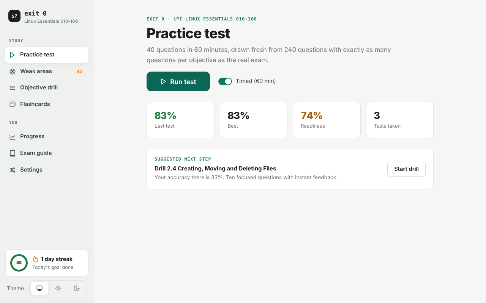
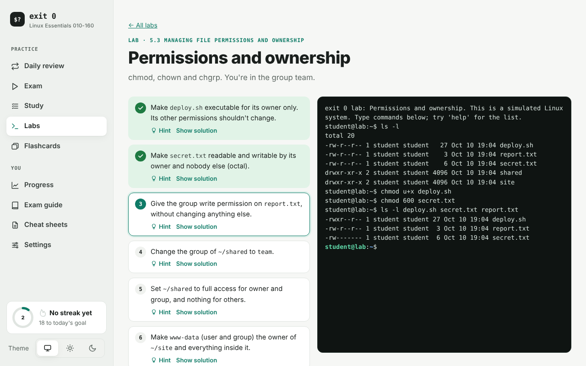
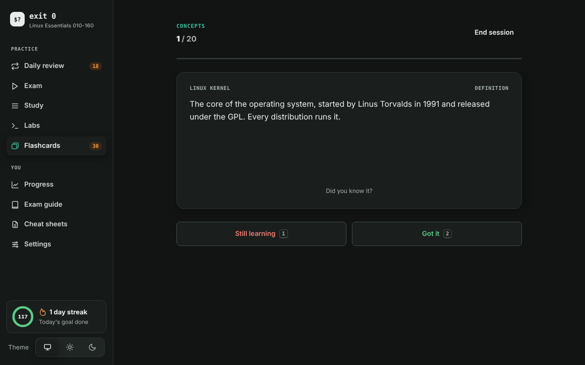

<p align="center">
  
</p>

<h1 align="center">exit 0</h1>

<p align="center">
  <b>Free practice for LPI Linux Essentials 010-160.</b><br>
  In Linux, <code>exit 0</code> means success, which is the goal here.
</p>

<p align="center">
  <a href="https://github.com/krink192/exit0-linux-essentials/releases/latest"></a>
  <a href="https://github.com/krink192/exit0-linux-essentials/actions/workflows/tests.yml"></a>
  <a href="LICENSE"></a>
</p>

<p align="center">
  <a href="https://krink192.github.io/exit0-linux-essentials/"><b>Open in your browser</b></a> — nothing to install, works offline
</p>



## Get it

| Platform | How |
|---|---|
| **Browser / phone** | [Open the web app](https://krink192.github.io/exit0-linux-essentials/). On a phone, add it to your home screen. |
| **Windows 10 / 11** | [Download Exit0.exe](https://github.com/krink192/exit0-linux-essentials/releases/latest/download/Exit0.exe) (single file, no installer) |
| **Fedora** | Signed dnf repo, see below |
| **Ubuntu / Debian** | Signed apt repo, see below |
| **Self-host (Docker)** | [exit0-sync](https://github.com/krink192/exit0-sync): the app plus accounts and sync for a homelab, class or team |

Every version is the same free app and works offline.

<details>
<summary><b>Fedora</b></summary>

```bash
sudo curl -fsSLo /etc/yum.repos.d/exit0.repo https://krink192.github.io/exit0-linux-essentials/repo/exit0.repo
sudo dnf install exit0
```
Accept the signing key with `y`. `sudo dnf upgrade` keeps it updated.
</details>

<details>
<summary><b>Ubuntu / Debian</b></summary>

```bash
sudo install -d -m 0755 /etc/apt/keyrings
sudo wget -qO /etc/apt/keyrings/exit0.asc https://krink192.github.io/exit0-linux-essentials/repo/exit0.asc
sudo wget -qO /etc/apt/sources.list.d/exit0.sources https://krink192.github.io/exit0-linux-essentials/repo/exit0.sources
sudo apt update && sudo apt install exit0
```
`sudo apt upgrade` keeps it updated.
</details>

<details>
<summary><b>Windows "protected your PC" warning</b></summary>

The app isn't code-signed yet. Click **More info → Run anyway**.
</details>

## What's inside

- **400 practice questions** in ten blueprint-matched sets, each with a hint, an explanation and a note on why every wrong option is wrong
- **Exam mode:** 40 questions, 60 minutes, weighted exactly like the real exam
- **Study mode:** pick objectives and difficulty, or jump straight to your misses and weak spots
- **Hands-on labs** for every LPI lesson that teaches commands, plus six troubleshooting scenarios, in a simulated terminal that works offline and on phones
- **Command drills and a sandbox** to practise commands with fresh files every run
- **Flashcards, daily review and a daily goal**, all on spaced repetition
- **Pass chance and exam plan:** see how ready you are and what to study next
- **Exam guide and printable cheat sheets** for every topic

| Labs | Progress | Flashcards |
|---|---|---|
|  |  |  |

## About the content

Written from LPI's published 010-160 objectives (v1.6) and the free lessons at [learning.lpi.org](https://learning.lpi.org). Command answers are verified on real Linux, and the lab terminal is tested against real Bash.

These are **original practice questions, not real exam questions**. LPI doesn't publish a pass percentage, so treat 80% here as a readiness signal.

## Contributing

Corrections and new questions are welcome: see [CONTRIBUTING.md](CONTRIBUTING.md). Building, testing and releasing: see [DEVELOPING.md](DEVELOPING.md).

## License

Copyright (C) 2026 krink192 and contributors. Free software under the [GNU Affero General Public License v3.0 or later](LICENSE), with no warranty. If you run a modified version for others over a network, you must offer them your source code.

Linux Essentials stays free. Practice packs for other certifications may be offered later as a separate paid product; see the [contributor license grant](CONTRIBUTING.md#contributor-license-grant). The name *exit 0* and the `$?` logo identify this project, so please rename forks.

Linux Essentials and LPI are trademarks of the Linux Professional Institute. This project is not affiliated with or endorsed by LPI. Linux is a registered trademark of Linus Torvalds.
