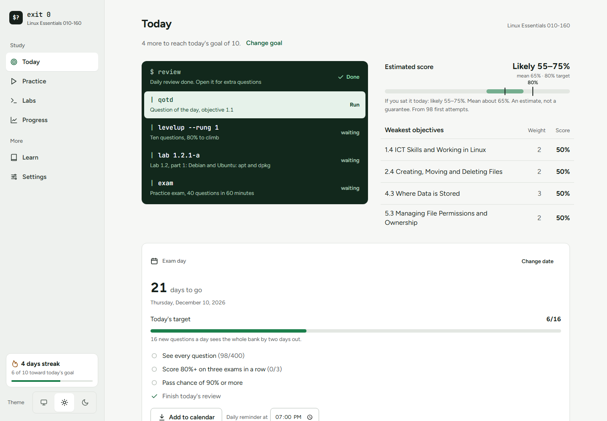
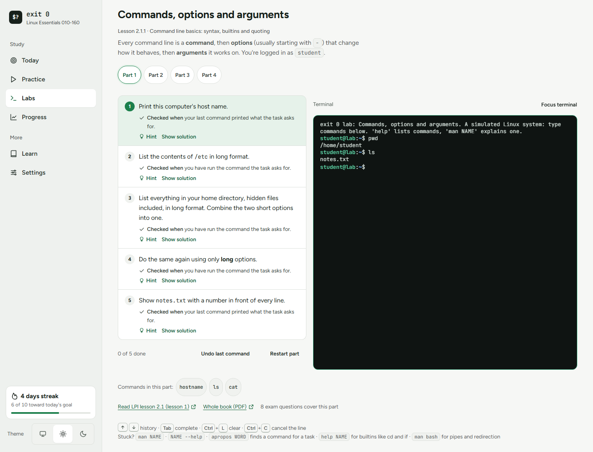

<p align="center">
  
</p>

<p align="center">exit 0</p>

<h1 align="center">Pass Linux Essentials 010-160. Free, offline, no account.</h1>

<p align="center">
  In Linux, <code>exit 0</code> means success, which is the goal here.
</p>

<p align="center">
  <a href="https://github.com/krink192/exit0-linux-essentials/releases/latest"></a>
  <a href="https://github.com/krink192/exit0-linux-essentials/actions/workflows/tests.yml"></a>
  <a href="LICENSE"></a>
</p>

exit 0 is free, offline practice for the LPI Linux Essentials 010-160 exam. It is for people learning Linux who want original questions, a hands-on terminal and a daily plan.

- Today shows one next step. The score is a range, and it stays hidden until you have enough fresh answers.
- Progress keeps all 19 objectives in view. Mastery is a correct first try on three different days.
- Labs check the commands you type. An exam is 40 questions in 60 minutes, and progress stays in your browser.



Today, with example progress: the next step, the estimated score and the weakest objectives.



A lab, with example progress: the tasks on the left, and a terminal with commands you have run.

## Get it

| Platform | How |
| --- | --- |
| **Browser / phone** | [Open the web app](https://krink192.github.io/exit0-linux-essentials/). On a phone, add it to your home screen. After it has loaded once, it opens offline. |
| **Windows 10 / 11** | [Download Exit0.exe](https://github.com/krink192/exit0-linux-essentials/releases/latest/download/Exit0.exe) (single file, no installer). Works offline. |
| **Fedora** | Signed dnf repo, see below |
| **Ubuntu / Debian** | Signed apt repo, see below |
| **Self-host (Docker)** | [exit0-sync](https://github.com/krink192/exit0-sync): the app plus accounts and sync for a homelab, class or team |

Every version is the same free app.

<details>
<summary><b>Fedora</b></summary>

```bash
sudo curl -fsSLo /etc/yum.repos.d/exit0.repo https://krink192.github.io/exit0-linux-essentials/repo/exit0.repo
sudo dnf install exit0
```

Accept the signing key with `y`. `sudo dnf upgrade` keeps it updated.
</details>

<details>
<summary><b>Ubuntu / Debian</b></summary>

```bash
sudo install -d -m 0755 /etc/apt/keyrings
sudo wget -qO /etc/apt/keyrings/exit0.asc https://krink192.github.io/exit0-linux-essentials/repo/exit0.asc
sudo wget -qO /etc/apt/sources.list.d/exit0.sources https://krink192.github.io/exit0-linux-essentials/repo/exit0.sources
sudo apt update && sudo apt install exit0
```

`sudo apt upgrade` keeps it updated.
</details>

<details>
<summary><b>Windows "protected your PC" warning</b></summary>

The app isn't code-signed yet. Click **More info → Run anyway**.
</details>

## What's inside

- Exam mode and ten fixed practice exams
- Daily review, short quizzes and study by objective
- Lesson labs, command drills and a sandbox
- Flashcards, bookmarks and an exam guide

## About the content

Written from LPI's published 010-160 objectives (version 1.6) and the free lessons at [learning.lpi.org](https://learning.lpi.org). These are original practice questions, not real exam questions. Command answers are checked on real Linux.

## Contributing

Corrections and new questions are welcome. See [CONTRIBUTING.md](CONTRIBUTING.md). Building, testing and releasing: see [DEVELOPING.md](DEVELOPING.md).

## License

Copyright (C) 2026 krink192 and contributors. Free software under the [GNU Affero General Public License v3.0 or later](LICENSE), with no warranty. If you run a modified version for others over a network, you must offer them your source code.

The bundled fonts, Figtree and JetBrains Mono, are under the [SIL Open Font License 1.1](docs/fonts/). The app loads nothing from other sites.

The default Green palette is original. The other colour schemes use published palette values, each under the MIT license: [GitHub Primer](https://github.com/primer/primitives) (GitHub Inc.), [Flexoki](https://stephango.com/flexoki) (Steph Ango), [Catppuccin](https://github.com/catppuccin/palette), [Tokyo Night](https://github.com/folke/tokyonight.nvim) and [Dracula](https://github.com/dracula/dracula-theme). The prompt's path colour is a second swatch from the same palette.

Linux Essentials stays free. Practice packs for other certifications may be offered later as a separate paid product; see the [contributor license grant](CONTRIBUTING.md#contributor-license-grant). The name *exit 0* and the `$?` logo identify this project, so please rename forks.

Linux Essentials and LPI are trademarks of the Linux Professional Institute. This project is not affiliated with or endorsed by LPI. Linux is a registered trademark of Linus Torvalds.
