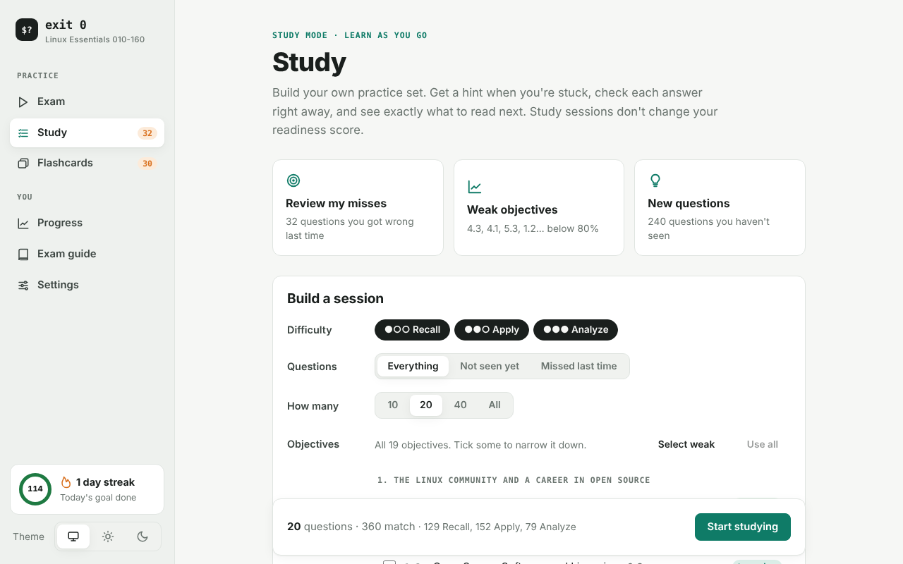
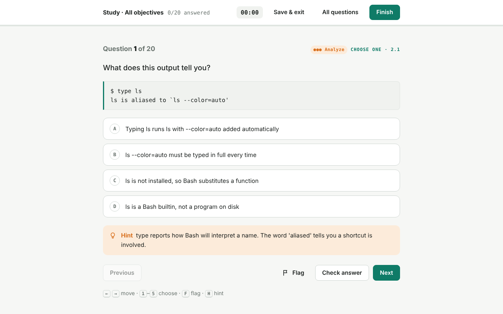
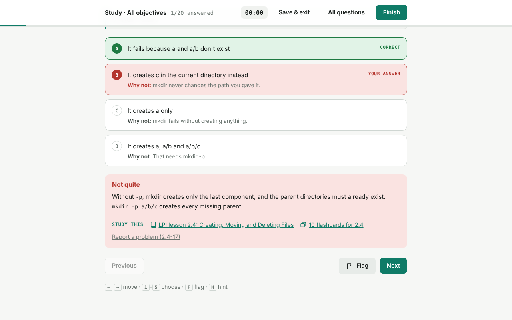
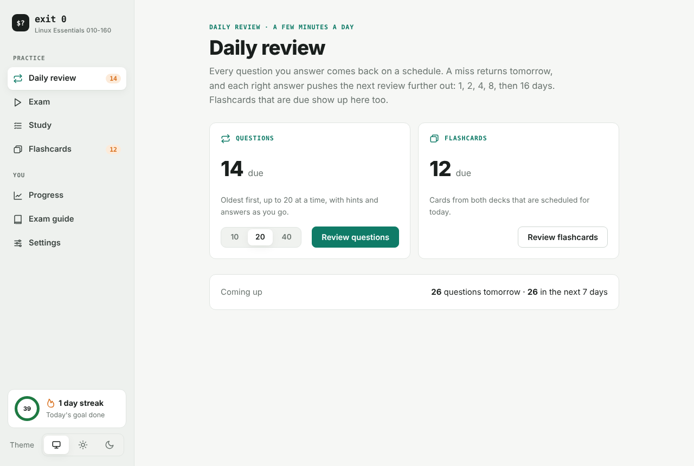

<p align="center">
  
</p>

<h1 align="center">exit 0</h1>

<p align="center">
  <b>Free practice for LPI Linux Essentials 010-160.</b><br>
  In Linux, <code>exit 0</code> means success, which is the goal here.
</p>

<p align="center">
  <a href="https://github.com/krink192/exit0-linux-essentials/releases/latest"></a>
  <a href="https://github.com/krink192/exit0-linux-essentials/actions/workflows/release.yml"></a>
  <a href="https://github.com/krink192/exit0-linux-essentials/actions/workflows/tests.yml"></a>
  <a href="LICENSE"></a>
  <a href="https://github.com/krink192/exit0-linux-essentials/releases"></a>
</p>

<p align="center">
  <a href="https://krink192.github.io/exit0-linux-essentials/"><b>Open in your browser</b></a> ·
  <a href="https://github.com/krink192/exit0-linux-essentials/releases/latest/download/Exit0.exe"><b>Windows</b></a> ·
  <a href="#fedora"><b>Fedora</b></a> ·
  <a href="#ubuntu--debian"><b>Ubuntu / Debian</b></a> ·
  <a href="#docker"><b>Docker</b></a>
</p>


## Get it

| Platform | How | Notes |
|---|---|---|
| **Any browser or phone** | [krink192.github.io/exit0-linux-essentials](https://krink192.github.io/exit0-linux-essentials/) | Nothing to install. On a phone, add it to your home screen and it works offline. |
| **Windows 10 / 11** | [Download Exit0.exe](https://github.com/krink192/exit0-linux-essentials/releases/latest/download/Exit0.exe) | A single file with no installer. |
| **Fedora** | [Add the repository](#fedora), then `sudo dnf install exit0` | Signed packages. Updates arrive with `dnf upgrade`. |
| **Ubuntu / Debian / Mint / Pop!_OS** | [Add the repository](#ubuntu--debian), then `sudo apt install exit0` | Signed repository. Updates arrive with `apt upgrade`. |
| **Docker** | `docker run -d -p 8080:8080 ghcr.io/krink192/exit0` | Self-host it for a class, team or homelab. amd64 and arm64. |

All versions are the same app, work offline once installed, and are free.

### Fedora
```bash
sudo curl -fsSLo /etc/yum.repos.d/exit0.repo https://krink192.github.io/exit0-linux-essentials/repo/exit0.repo
sudo dnf install exit0
exit0            # or open "exit 0" from your app menu
```
The first install asks you to accept the exit 0 signing key; answer `y`. After that, `sudo dnf upgrade` keeps it
up to date along with the rest of your system. To remove it, run `sudo dnf remove exit0` and delete
`/etc/yum.repos.d/exit0.repo`.

If you don't want a repository, install a single release with
`sudo dnf install https://github.com/krink192/exit0-linux-essentials/releases/latest/download/exit0.rpm`.

### Ubuntu / Debian
```bash
sudo install -d -m 0755 /etc/apt/keyrings
sudo wget -qO /etc/apt/keyrings/exit0.asc https://krink192.github.io/exit0-linux-essentials/repo/exit0.asc
sudo wget -qO /etc/apt/sources.list.d/exit0.sources https://krink192.github.io/exit0-linux-essentials/repo/exit0.sources
sudo apt update && sudo apt install exit0
exit0            # or open "exit 0" from your app menu
```
After that, `sudo apt upgrade` keeps it up to date. To remove it, run `sudo apt remove exit0` and delete the two
files you downloaded above.

If you don't want a repository, download
[exit0.deb](https://github.com/krink192/exit0-linux-essentials/releases/latest/download/exit0.deb) and run
`sudo apt install ./exit0.deb`.

### Windows
Download **[Exit0.exe](https://github.com/krink192/exit0-linux-essentials/releases/latest/download/Exit0.exe)** and run it.
Windows may show *"Windows protected your PC"* because the app isn't code-signed. Click **More info → Run anyway**.
It uses the Microsoft Edge WebView2 runtime that comes with Windows 10 and 11.

### Docker
```bash
docker run -d --name exit0 -p 8080:8080 --restart unless-stopped ghcr.io/krink192/exit0:latest
```
Then open http://localhost:8080 (or the server's address). The repository also has a [compose.yaml](compose.yaml),
so `docker compose up -d` works too. The image is nginx serving the same web app. It runs as a non-root user,
listens on port 8080 and has a health check. Versions are tagged as `1.2.1`, `1.2` and `latest`.
To update, run `docker pull ghcr.io/krink192/exit0:latest` and recreate the container.
Progress is still saved in each person's browser, not on the server, so many people can share one container.

**Where progress is saved:** in your browser for the web version and Docker, `~/.local/share/exit0` on Linux, and `%APPDATA%\Exit0`
on Windows. To move it between devices, use **Settings → Your data**.

**Linux window opens and closes right away?** Update to the latest version. If it still happens, run
`GDK_BACKEND=x11 exit0` and [open an issue](https://github.com/krink192/exit0-linux-essentials/issues/new?template=bug.yml)
with the terminal output.

## Two ways to practice

| | **Exam** | **Study** |
|---|---|---|
| Goal | Test yourself the way the real exam will | Learn the material and fix weak spots |
| Questions | 40, with exactly as many per objective as the real exam | You choose: objectives, difficulty, how many, and all, unseen or missed |
| Time | 60-minute countdown | No limit |
| Answers | Hidden until you submit | Checked as you go, with the explanation |
| Help | None, as on test day | A hint for every question, plus links to the LPI lesson and matching flashcards |
| Readiness score | Counts | Doesn't count |

| Build a study session | Hint when you're stuck | What to read next |
|---|---|---|
|  |  |  |

## What's inside

- **360 questions.** Single-answer, choose-two/three and type-the-command questions, each tagged *Recall*,
  *Apply* or *Analyze* (129, 152 and 79 of them) and each with a written explanation and a hint.
- **Daily review.** Every question you answer comes back on a schedule: a miss returns tomorrow, and each right
  answer pushes it further out (1, 2, 4, 8, then 16 days). Due flashcards are included, so a few minutes a day
  keeps everything fresh.
- **Install on your phone.** Add it to your home screen from the browser (Settings → Install on this device).
  It opens like an app and works offline.
- **Exam mode.** A fresh 40-question exam every time, matching LPI's blueprint exactly (weight = number of
  questions). Flag questions, review them, then submit and see every answer explained.
- **Study mode.** Pick objectives, difficulty and question count, or start with one click from *Review my misses*,
  *Weak objectives* or *New questions*.
- **Progress.** A readiness score (the average of your last three exams), score trend, troubled sections,
  mastery of each objective, accuracy by difficulty, and a full history you can review.
- **Flashcards.** 250 cards in two decks, *Concepts* and *Commands & files*, with spaced repetition, so cards
  you miss come back first. There's also a searchable glossary.
- **Exam guide.** Format, scoring, the blueprint with links to LPI's free lessons, a study plan and test-day tips.
- **Daily goal and streak.** Keeps you studying a little every day.
- **Report a problem.** Every question has a link that opens a GitHub issue with its ID filled in.
- **Light and dark themes,** following your system setting or chosen in Settings.

| Daily review | Progress | Flashcards (dark) |
|---|---|---|
|  |  |  |

## How the content was made and checked

- Questions and flashcards were written from LPI's published 010-160 objectives (v1.6) and the free
  lessons at learning.lpi.org. Every item on each objective's "terms and utilities" list is covered.
- **166 command-based questions were run on a real Linux system** (`tools/verify.py`), including every
  accepted fill-in answer. The output must match the answer key.
- The build checks blueprint counts, duplicates, that every question has a hint, and whether the correct
  answer tends to be the longest option (it is the longest in 14% of single-answer questions, below the 25%
  you'd expect by chance).
- `node tools/test_core.js` tests the exam and study logic, including 200 randomly generated exams that are
  each checked against the blueprint, and checks that no hint gives away a typed answer.
- Every release installs the `.deb` on Ubuntu and the `.rpm` on Fedora before publishing them, checks the
  `.rpm` signature, and then installs both again from the live signed repositories.

These are **original practice questions, not real exam questions**. LPI scores the real exam from
200 to 800, and 500 passes, with no published percentage. Treat 80% here as a readiness signal.

## For developers

### Project layout
```
docs/                 The web app (published by GitHub Pages)
  index.html, css/, js/core.js (logic), js/app.js (interface)
  data/bank.js, data/cards.js   generated, do not edit by hand
desktop/              Windows wrapper (pywebview), Linux launcher + .deb/.rpm config (desktop/linux), app icon
.github/workflows/    tests.yml (every push), release.yml (desktop builds), pages.yml (website + package repo),
                      docker.yml (container image)
Dockerfile, docker/   Container image: nginx serving docs/ (compose.yaml for docker compose)
bank.json             The question bank
tools/                Questions t1.py–t6.py, hints.py, cards.py, build.py, verify.py, test_core.js
```

### Releasing
```bash
gh release create v1.2.0 --title "exit 0 v1.2.0" --notes "What changed"
```
`release.yml` runs the tests, builds `Exit0.exe`, `exit0.deb` and `exit0.rpm`, signs the `.rpm`, installs both
Linux packages on Ubuntu and Fedora, and attaches all three to the release. When it finishes, `pages.yml`
republishes the website and the signed dnf/apt repository, then installs from that repository to make sure it works.
`docker.yml` builds the container image, runs it and checks that it serves the app, then publishes it to
`ghcr.io/krink192/exit0` for amd64 and arm64.

To try the image locally: `docker build -t exit0 . && docker run --rm -p 8080:8080 exit0`.

### One-time setup: website and package signing
1. **Pages:** Settings → Pages → Source: **GitHub Actions**, or run
   `gh api -X PUT repos/krink192/exit0-linux-essentials/pages -f build_type=workflow`.
2. **Signing key:** create a key that is used only for packages, and store it as a repository secret:
   ```bash
   gpg --batch --pinentry-mode loopback --passphrase '' \
       --quick-gen-key "exit 0 packages <krink192@users.noreply.github.com>" rsa4096 sign never
   gpg --armor --export-secret-keys "exit 0 packages" | gh secret set PACKAGE_SIGNING_KEY
   ```
   Keep a backup of the key (`gpg --armor --export-secret-keys "exit 0 packages" > exit0-signing-key.asc`,
   stored somewhere safe and offline). Without the secret, releases still build, but the `.rpm` stays unsigned
   and only the website is published.

## Contributing
Corrections and new questions are welcome. See [CONTRIBUTING.md](CONTRIBUTING.md).

## License
Copyright (C) 2026 krink192 and contributors. Free software under the **GNU General Public License v3.0
or later**. See [LICENSE](LICENSE). It comes with no warranty.

Linux Essentials and LPI are trademarks of the Linux Professional Institute. This project is not affiliated
with or endorsed by LPI. Linux is a registered trademark of Linus Torvalds.
