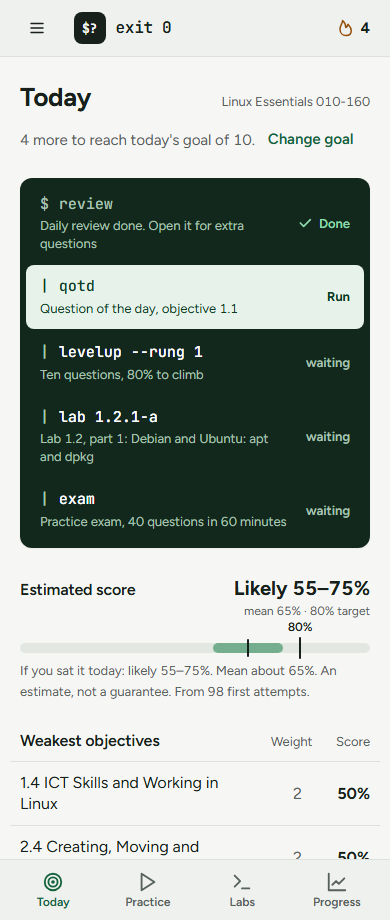
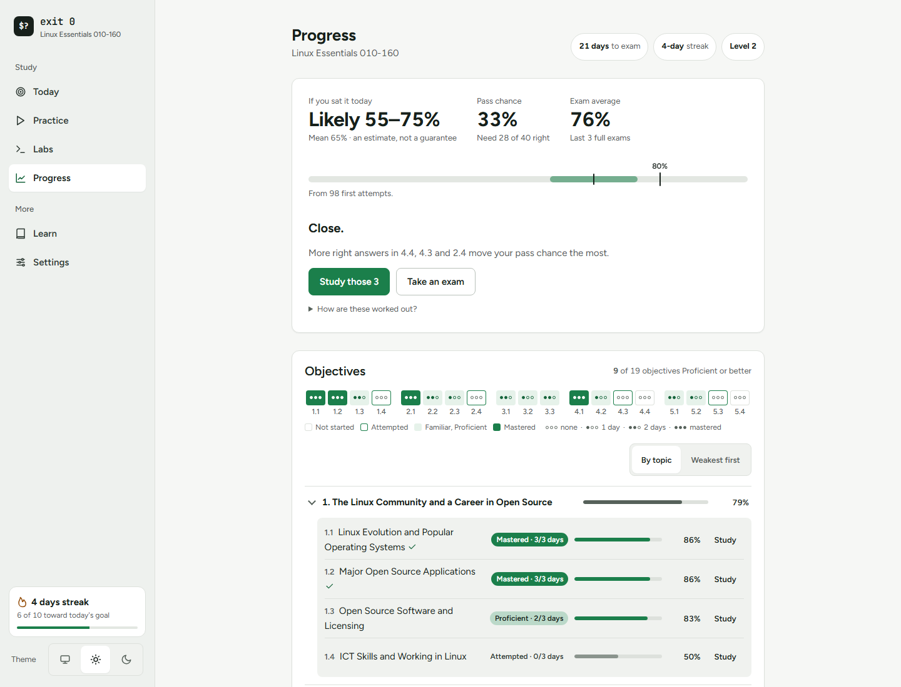
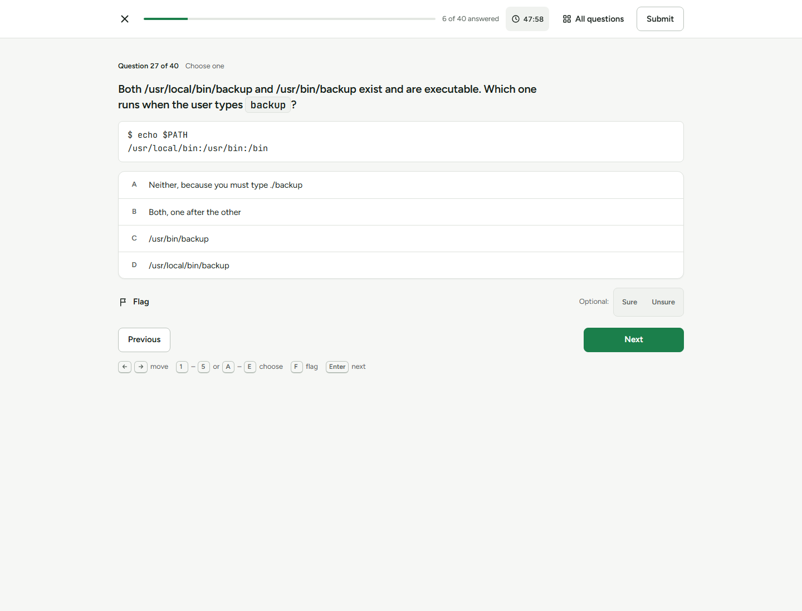

<p align="center">
  
</p>

<p align="center">exit 0</p>

<h1 align="center">Pass Linux Essentials 010-160. Free, offline, no account.</h1>

<p align="center">
  In Linux, <code>exit 0</code> means success, which is the goal here.
</p>

<p align="center">
  <a href="https://github.com/krink192/exit0-linux-essentials/releases/latest"></a>
  <a href="https://github.com/krink192/exit0-linux-essentials/actions/workflows/tests.yml"></a>
  <a href="LICENSE"></a>
</p>

| Questions | Objectives | Lab parts | Commands with man pages | Flashcards | Offline | Tracking |
| --- | ---: | ---: | ---: | ---: | --- | --- |
| 459 | 19 | 96 | 115 | 250 | Yes, once loaded | None |

The 459 questions are the whole bank: ten fixed exams of 40, plus 59 reworded or typed variants of the same facts. The 96 lab parts are 65 parts across 21 command lessons, 7 parts across 6 troubleshooting lessons, 4 named scenarios and 20 short challenges. The 115 man pages are the command pages in the lab terminal (sections 1 and 8). Twelve more pages cover file formats and overviews, and none of them is a copy of a system manual. Counts are from this version of the app.

<p align="center">
  <a href="https://krink192.github.io/exit0-linux-essentials/"><b>Open the app</b></a> — nothing to install
</p>

The pictures below are the real app with example progress filled in, so the screens are not empty. Those scores are not a promise.

## You open it and don't know what to study

Today puts one next step first, then the rest of the plan: daily review, the question of the day, a lab, and a full exam. The estimate is a likely range. It stays hidden until there are 40 first attempts, with at least 3 in every topic.


The same screen on a phone:



## A single percentage hides the weak objectives

Progress keeps all 19 objectives on one map: not started, attempted, familiar, proficient, or mastered. Mastery is a correct first attempt on three different days, not one long sitting. Next to the map, the estimate stays a range.



## Recognizing an answer is not the same as typing it

Lesson labs and the troubleshooting scenarios run in a simulated terminal. It works offline, including on a phone. A task is checked from the result of what you typed.


Exam mode is separate from that: 40 questions, 60 minutes, weighted like LPI's published blueprint. Fixed exams A to J share no questions, so a retake is a new sitting.



## Questions people ask

**Is this the official exam?** No. The questions are original, written from LPI's published 010-160 objectives (version 1.6) and the free lessons at [learning.lpi.org](https://learning.lpi.org). This project is not affiliated with or endorsed by LPI.

**How does the estimate work?** It counts a first attempt at each fact, and an answer given 4 days or more after the last one. Repeats, and answers given after a hint, are left out. It is hidden until those first attempts reach 40, with at least 3 in every topic, and it is shown as a likely range. Pass chance assumes 70% because LPI does not publish the raw cut. The 80% line is the study target in the app. It is an estimate, not a guarantee.

**What gets stored, and where?** Progress stays in the browser unless you set up sync. There is no account and no analytics. Optional sync sends progress only to an [exit0-sync](https://github.com/krink192/exit0-sync) server you run yourself. The app loads its own fonts and scripts, nothing from another site.

## Get it

| Platform | How |
| --- | --- |
| **Browser / phone** | [Open the web app](https://krink192.github.io/exit0-linux-essentials/). On a phone, add it to your home screen. After it has loaded once, it opens offline. |
| **Windows 10 / 11** | [Download Exit0.exe](https://github.com/krink192/exit0-linux-essentials/releases/latest/download/Exit0.exe) (single file, no installer). Works offline. |
| **Fedora** | Signed dnf repo, see below |
| **Ubuntu / Debian** | Signed apt repo, see below |
| **Self-host (Docker)** | [exit0-sync](https://github.com/krink192/exit0-sync): the app plus accounts and sync for a homelab, class or team |

Every version is the same free app.

<details>
<summary><b>Fedora</b></summary>

```bash
sudo curl -fsSLo /etc/yum.repos.d/exit0.repo https://krink192.github.io/exit0-linux-essentials/repo/exit0.repo
sudo dnf install exit0
```

Accept the signing key with `y`. `sudo dnf upgrade` keeps it updated.
</details>

<details>
<summary><b>Ubuntu / Debian</b></summary>

```bash
sudo install -d -m 0755 /etc/apt/keyrings
sudo wget -qO /etc/apt/keyrings/exit0.asc https://krink192.github.io/exit0-linux-essentials/repo/exit0.asc
sudo wget -qO /etc/apt/sources.list.d/exit0.sources https://krink192.github.io/exit0-linux-essentials/repo/exit0.sources
sudo apt update && sudo apt install exit0
```

`sudo apt upgrade` keeps it updated.
</details>

<details>
<summary><b>Windows "protected your PC" warning</b></summary>

The app isn't code-signed yet. Click **More info → Run anyway**.
</details>

## What's inside

- **Exam mode:** 40 questions, 60 minutes, weighted like the published blueprint
- **Quick practice:** question of the day, Quick 10, 5- and 10-minute quizzes, and Level Up, a nine-step ladder that gets harder
- **Fixed practice exams A to J:** ten set exams with no shared questions
- **Study mode:** pick objectives and difficulty, or start from misses and weak objectives
- **Hands-on questions:** matching and ordering, outside the exam bank
- **Bookmarks, notes and search**
- **Command drills and a sandbox**, with fresh files every run
- **Flashcards, daily review and a daily goal**, on spaced repetition
- **Exam guide and printable cheat sheets** for every topic

## About the content

Written from LPI's published 010-160 objectives (v1.6) and the free lessons at [learning.lpi.org](https://learning.lpi.org). Command answers are checked on real Linux, and the lab terminal is tested against real Bash.

These are original practice questions, not real exam questions.

## Contributing

Corrections and new questions are welcome: see [CONTRIBUTING.md](CONTRIBUTING.md). Building, testing and releasing: see [DEVELOPING.md](DEVELOPING.md).

## License

Copyright (C) 2026 krink192 and contributors. Free software under the [GNU Affero General Public License v3.0 or later](LICENSE), with no warranty. If you run a modified version for others over a network, you must offer them your source code.

The bundled fonts, Figtree and JetBrains Mono, are under the [SIL Open Font License 1.1](docs/fonts/). The app loads nothing from other sites.

Linux Essentials stays free. Practice packs for other certifications may be offered later as a separate paid product; see the [contributor license grant](CONTRIBUTING.md#contributor-license-grant). The name *exit 0* and the `$?` logo identify this project, so please rename forks.

Linux Essentials and LPI are trademarks of the Linux Professional Institute. This project is not affiliated with or endorsed by LPI. Linux is a registered trademark of Linus Torvalds.
